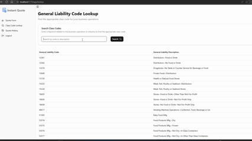

# 💼 InstantQuote

**InstantQuote** is a modern web application that allows companies to quickly generate quotes with minimal friction. Users can securely create accounts, log in, search class codes with intelligent autocomplete, and instantly generate accurate quotes — all in a responsive, production-ready UI.



---

## 🚀 Features

- 🔐 **Secure Cookie-Based Authentication** – Sessions managed via cookies.  
- 🧠 **Smart Class Code Lookup** – Real-time autocomplete for class codes.
- ⚡ **Instant Quote Generation** – Generate accurate quotes with minimal input.
- 🗂️ **Account Portal** – Users can register, log in, and manage their quote requests.  
- 🎨 **Modern UI** – Built with shadcn/ui and styled with Tailwind CSS.  
- ⚙️ **Fast Build** – Powered by Vite for lightning-fast development.

---

## 🛠 Tech Stack

| Layer       | Technology                       |
|-------------|----------------------------------|
| Frontend    | React, JavaScript, Vite, shadcn/ui |
| Backend     | Node.js, Express.js              |
| Database    | MongoDB           |
| Auth        | Cookie-based authentication      |
| Styling     | Tailwind CSS                     |

---

## 📸 Demo

[](https://www.youtube.com/watch?v=M8mTlUCRnEg)

---

## 📦 Installation

### 1. Clone the Repository

```bash
git clone https://github.com/SahisN/InstantQuote.Frontend.git
git clone https://github.com/SahisN/InstantQuote.Backend.git
cd instantquote.Frontend
npm i
npm run dev
